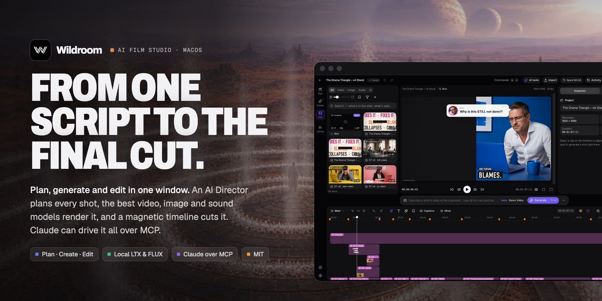
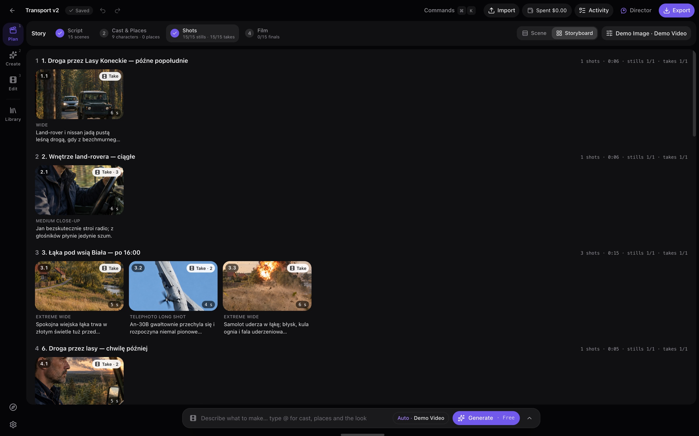
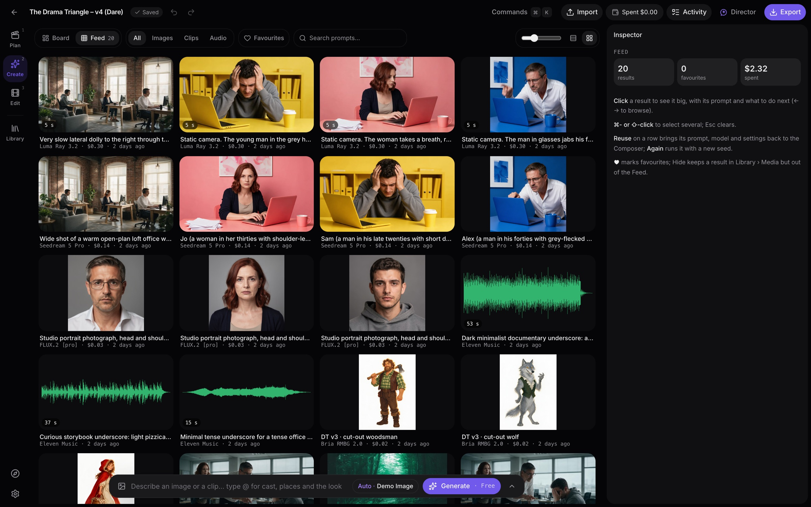
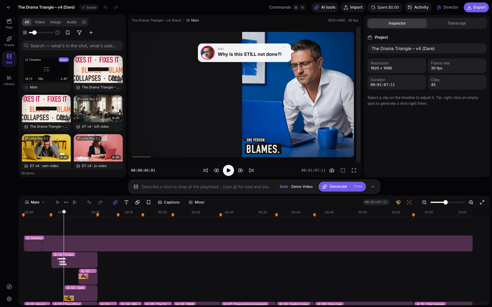

# Wildroom



**An AI film studio for macOS.** Write the story, design the cast and places, let an AI Director plan every shot,
render it with the best video, image and sound models, and cut it on a Final Cut Pro–style magnetic timeline — one
project, one shared media library. The same studio makes explainers, ads, brand identity and web assets, and Claude
can drive all of it over MCP.

Everything runs on your Mac: a Vue app in the browser (or the desktop app) talks to a small Node server on
`127.0.0.1`. API keys live in the macOS Keychain.

**[The story behind it and the film made with it → szymonkubisa.com/work/wildroom](https://szymonkubisa.com/work/wildroom)**

## At a glance

- **Plan · Create · Edit** — from one sentence to a script, a storyboard, generated shots and a finished cut.
- **Every major model in one Composer** — Kling, Veo, Seedance, FLUX, GPT Image, ElevenLabs and more, with the price
  before you render; LTX-2.5 and FLUX.2 run locally for free.
- **A real editor** — magnetic timeline, connected clips, takes as auditions, transcripts, mixer and motion graphics.
- **Claude over MCP** — Claude Code and Claude Desktop build projects in the running app, with a spend cap.
- **Projects are folders** — copy, sync or open them anywhere.
- **Demo mode** — every workflow works without API keys.

## Features

**Plan · Create · Edit** — three workspaces over one project, with one Library drawer (media, cast, places, brand kit)
and one Composer at the bottom of Create and Edit for every generation (in Plan, each shot card has its own prompts).

### Plan — from a sentence to a shot list
- **Start from a sentence**: say what you are making (film, ad, social post, edit) and the AI Director writes the
  script, scenes and shots, then proposes what to generate — nothing renders until you approve the plan.
- **AI Director** chat beside every workspace: ask for stills, takes, a golden-hour scene, a shorter cut or music and
  get a plan with each step's cost and time. Runs on Claude, GPT, Gemini, DeepSeek or any OpenRouter text model.
- **Story steps**: Script → Cast & Places → Shots → Film, scene by scene, with progress per scene.
- **Consistent cast and places**: each character has a look, reference images and a voice; each place a look and
  photos — every shot's still uses them.
- **Storyboard** of every scene's stills and takes, **batch generation** with a cost check first, and **Update
  timeline** to lay the chosen takes and dialogue on the story cut.
- **Shots from one image**: a wide, a close-up, the reverse… of the same moment, drawn from one still so the people,
  the place and the light stay — added as new shots after the shot.
- **Blender previs**: a grey-box scene with its camera moves, built in Blender, sets the camera and blocking of the
  generated shot ([docs/blender-previs.md](docs/blender-previs.md)).



### Create — generate and compose
- **Video, image and audio models**: Kling 3.0, Veo 3.1, Seedance, Wan, Luma, MiniMax, GPT Image 2.5, Nano Banana,
  Seedream, FLUX, Recraft, ElevenLabs voices, dialogue, music and sound effects, lip-sync, foley, upscaling — via
  Kling's API, fal.ai and OpenRouter.
- **Local and private**: LTX-2.5 video and FLUX.2 images run on this Mac (MLX) for free; LTX-2.5 can also run on a
  rented RunPod GPU with ComfyUI.
- **Start and end frames and camera moves** (push-in, orbit, crane, FPV, dolly zoom…) worded for each model.
- **Look tiles**: Camera (framing and lens), Lighting and Color picked from miniatures, Auto until set.
- **References** picked from what was generated, uploaded, the cast and places or the favourites; **prompt
  enhance**; and **takes** — several variants in one clip, flipped in place.
- **Recipes** with animated previews, by group and searchable.
- **Prompt history** beside the Composer: every prompt of the project, searchable — copy it, Reuse it with its model,
  settings and inputs, or Run it again with a new seed.
- **Feed**: every result with its prompt, model and cost; Reuse brings the settings back, Again re-rolls with a new seed.
- **Infinite canvas**: boards of images, notes, text and shapes; selected images become references; frames of exact
  sizes (OG image, Instagram, story, YouTube thumbnail, ads); more angles of one image beside it; remove background,
  vectorize, favicon and app-icon packs.
- **Brand kit**: palette extracted from your logo, fonts, logos, style and voice — optionally applied to every
  generation. **Brief → asset set** plans and generates a matching set of brand, web and social images.
- **Activity**: one queue for everything, with live progress, pause, reorder and a full history of every render's
  settings, inputs, time and cost.



### Edit — a real editor



- **Magnetic storyline** with connected clips; append, insert, connect and overwrite (E W Q D), ripple and roll trim,
  slip, slide, blade, snapping to edges, markers and music beats, J/K/L — Final Cut–style shortcuts throughout.
- **Motion graphics on the timeline**: canvas frames become animated clips — keyframed tracks with easing, kinetic and
  masked type, paths, groups and camera moves; whole explainers come in from one JSON file
  ([docs/motion-import.md](docs/motion-import.md)).
- **Clip look**: transform and crop, keyframes, colour and effects, match colour, speed, freeze and reverse,
  transitions, titles and captions.
- **AI editing**: generative extend (before or after a shot), fill a gap with a bridging shot, edit inside a shot,
  new takes, continuity check across every cut, smart reframe to vertical or square, split a long clip into shots.
- **Sound**: dialogue, music and effects roles with a mixer, auto-ducking, dialogue levelling, volume keyframes and
  fades, isolate voice, beat detection, foley from the picture.
- **Transcripts**: word-accurate transcription with speakers, edit by deleting words, remove fillers and long pauses,
  timed captions (burn in or SRT/VTT).
- **Export**: H.264 or HEVC MP4 with loudness normalisation (−14/−16/−23 LUFS) and burned-in captions, or Final Cut
  Pro XML.

### Library and projects
- Plain-language **search** by what is in the shot, what is said in it, its prompt or keywords; **Describe with AI**
  for searchable descriptions; keywords, favourites and smart collections.
- **Projects are folders** you can copy, sync or open anywhere ([below](#projects-are-folders)); tags, pins and search
  on the home screen.
- **Demo mode** with free stand-in generators, so every workflow can be tried without API keys.

### Claude (MCP)
Claude Code and Claude Desktop can build in the app over MCP: create projects, build explainers from one
motion-import file, generate and look at the results, edit the timeline by clip id, plan with the Director, and
export. Paid renders always come back with their price first and need your go-ahead; each Claude session has a
spend cap. Setup [below](#connect-claude-mcp) and in [docs/mcp.md](docs/mcp.md).

## Get started

Needs a Mac (Apple Silicon for the local models and the desktop app), Node.js 22.12+ and pnpm.

```bash
git clone https://github.com/szymonkubisa/wildroom.git
cd wildroom
pnpm install
pnpm dev
```

Open http://127.0.0.1:5180 in Chrome, Edge or Arc (export uses WebCodecs).

- Demo mode (on by default) adds free local generators so you can try the whole workflow without API keys.
- Add your ElevenLabs, Kling, fal.ai and (optionally) OpenRouter keys in **Settings → Providers**. OpenRouter runs
  the AI Director's text models and image models such as GPT Image 2.5, Nano Banana, Seedream and FLUX.3. Keys go
  straight to the Keychain and never reach the browser.
- Local models: `pnpm models:ltx` installs LTX-2.5 video and `pnpm models:flux2` FLUX.2 images (MLX, on this Mac).

Production-style run: `pnpm build && pnpm start` (the server then serves the built app on http://127.0.0.1:7777).

## Desktop app

The same app packaged as a macOS app (Electron, Apple Silicon):

```bash
pnpm electron:dev     # runs `pnpm dev` (or reuses a running one) and opens it in an Electron window
pnpm electron:build   # → release/mac-arm64/Wildroom.app and release/Wildroom-<version>-arm64.dmg
pnpm electron:start   # production mode without packaging (runs the staged app in dist-electron/app)
```

- The packaged app starts the API server itself, on port 7777 when it is free (otherwise a random local port), and
  stops it on quit. If the server cannot start you get a dialog with its output; the full log is in
  `~/Library/Logs/Wildroom/server.log` (Help → Show Server Log).
- It uses the same projects, app data and Keychain entries as the web version, but **only one of them can run at a
  time**: the server holds `~/Library/Application Support/Wildroom/.studio.lock`, and a second instance refuses
  to start instead of running a second job worker. Quit the app before `pnpm dev` / `pnpm start` and vice versa.
  (With a different `STUDIO_HOME` they can run side by side — start `pnpm dev` first, since it needs port 7777.)
- File → Open Project… (⌘O), Open Recent and double-clicking a `.wildroom` in Finder open projects; ⇧⌘W closes the
  current one.
- Install: open the dmg and drag the app to Applications. The build is ad-hoc signed, not notarized: it opens directly
  on the Mac that built it; on another Mac allow it once in System Settings → Privacy & Security → *Open Anyway*.
  Because it has no Developer ID (and the web version runs as `node`), macOS asks once per build for Keychain access to
  keys saved by the other one — choose *Always Allow*. Signing and notarizing, Gatekeeper and testing with a scratch
  `STUDIO_HOME`: [docs/desktop-app.md](docs/desktop-app.md).
- The native addons are Node-API builds, so the same `node_modules` serve `pnpm dev`, `pnpm test` and the desktop
  build. The first build needs network access (the dmg tool); later builds reuse it.

## Connect Claude (MCP)

Claude Code and Claude Desktop can build in the app over MCP: projects, explainers from one motion-import file
([docs/motion-import.md](docs/motion-import.md)), renders it can look at, timeline edits, Director plans and exports.
The endpoint is `/mcp` on the app's own server (loopback only, with a per-install token); **Settings → Integrations**
has the copy-ready setup:

```bash
claude mcp add --scope user wildroom -- node /path/to/wildroom/scripts/studio-mcp.mjs
```

Paid renders always come back with their price first and need your go-ahead; each Claude session has a spend cap.
Details: [docs/mcp.md](docs/mcp.md).

## Projects are folders

Like a Final Cut Pro library, every project is one self-contained folder — `My Film.wildroom` — that you can copy to
another Mac, put on a drive, or keep in iCloud Drive / Dropbox, then open with **Open…** (or a double-click in Finder,
with the desktop app installed, where it shows as a single document):

```
My Film.wildroom/
  project.json            timeline, story, mix, settings
  Assets/<id>.json        one file per asset: name, rating, keywords, transcript, beats, generation summary…
  Generations/<id>.json   one file per generation: model, prompt, parameters, cost, status, outputs
  Media/<sha256>.<ext>    every original — imports are always copied in; generations and renders land here too
```

- New projects go to `~/Movies/Wildroom/` (Settings → General → Projects folder), but a project can live
  anywhere.
- One JSON file per record, written atomically, so sync services merge folders file by file. A project open on one
  computer shows as *Open on …* on the other; a `project.json` changed elsewhere while open is kept in the project's
  `Conflicts/` folder, and rotating backups go to app data.
- Copies get their own identity when opened next to the original (new ids; unfinished generations are canceled in the
  copy, so nothing is paid for twice). Generations queued on another computer wait for you to retry them.
- Machine-local things stay out of projects: proxies, thumbnails and waveforms in `~/Library/Caches/Wildroom/`
  (rebuilt automatically, clearable in Settings), settings and the recent-projects list in
  `~/Library/Application Support/Wildroom/`, local model weights in its `Models/` folder.
- `STUDIO_HOME=<dir>` puts all of it in one folder (tests use this); `STUDIO_PROJECTS_DIR`, `STUDIO_CACHE_DIR`,
  `STUDIO_MODELS_DIR` move single parts.

## Workflow

1. **Plan** (optional): start from a sentence or a script; the AI Director writes scenes and shots, and the story
   steps take each shot from still to take to the film's timeline.
2. **Generate** with the Composer at the bottom: pick a kind (Video, Image, Voice, Dialogue, Music, SFX…) and a model;
   the form, price estimate and number of takes come from the model registry. Results land in the Library and the Feed.
3. **Edit** on the timeline: primary storyline (magnetic) plus connected clips above (video/titles) and below (audio).
   Drag from the Library or use E / W / Q / D. Blade (⌘B), trim, roll/slip (T), transitions (⌘T), titles, markers,
   undo/redo.
4. **AI on the timeline**: right-click → *Generate shot here*, *Generate new take* (takes behave like FCP auditions —
   ⌃← / ⌃→), *Extend shot* from an asset, *Animate* an image, grab the frame under the playhead as a start frame.
5. **Export** (⌘E): H.264/HEVC, loudness-normalised (−14/−16/−23 LUFS); the render appears in the Library.

Press ⌘K for the command palette; all shortcuts are listed in Settings → Shortcuts, and every feature in the app's
Features guide.

## Development

```bash
pnpm test        # vitest (timeline core, server, providers)
pnpm typecheck   # vue-tsc for client, shared and server
```

Layout: `src/shared` (timeline model and ops, model registry, types), `src/server` (Hono API, project bundles in
`storage/`, ingest, job worker, provider adapters, MCP server in `mcp/`), `src/client` (Vue UI,
playback/compositor/export engine), `electron` (desktop shell: main process, preload), `scripts/build-electron.mjs`
(desktop build), `scripts/studio-mcp.mjs` (MCP stdio bridge).

## License

[MIT](LICENSE) © 2026 [Szymon Kubisa](https://szymonkubisa.com).

The desktop build bundles an [FFmpeg](https://ffmpeg.org) binary from
[`ffmpeg-static`](https://github.com/eugeneware/ffmpeg-static), which is licensed under the GPL-3.0; it runs as a
separate program and keeps its own license. Models and provider APIs used by the app (LTX, FLUX, Kling,
ElevenLabs…) have their own terms.
